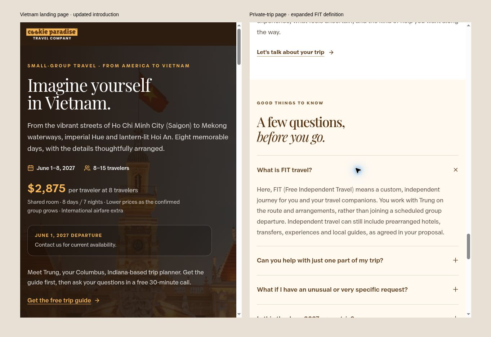
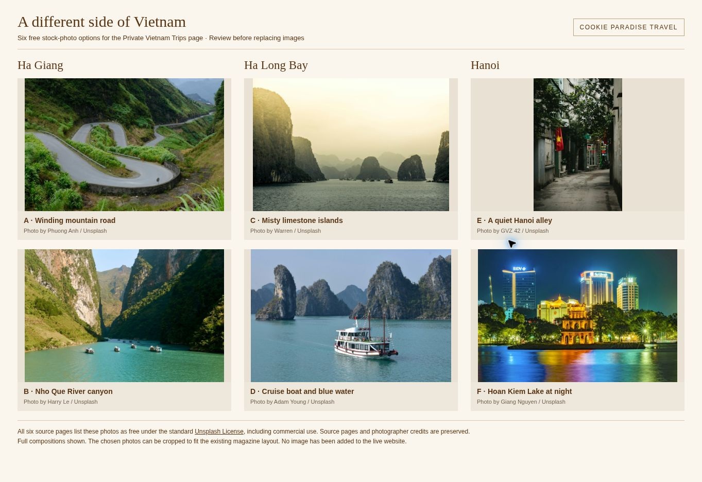

# FIT wording and northern Vietnam photo options

Prepared November 3, 2026 from clean main commit `cc49439d06ed3c6e1e1f30af2be21b7af8cdca59`. No `AGENTS.md` was found.

## Copy changes

- The shared Vietnam landing-page introduction now says **From America to Vietnam**. The prior slogan had one occurrence in tracked website source. Referral variants use this same page. The public trip-guide PDF did not contain the old slogan.
- The FIT FAQ now starts **Here, FIT (Free Independent Travel) means…**, retaining the rest of the requested paragraph.

Production build, TypeScript, affected-page ESLint, and `git diff --check` passed. The two changes were also reviewed in a static browser proof generated from the actual page components and built CSS; the FIT FAQ was opened to confirm the complete answer is visible. This preview stubs availability and does not submit forms. No new tests were added for these two text edits.

## Photo shortlist

These are proposed replacements for the private-trip page only. No website photos, photo captions, trip-idea copy, or social-preview image have been replaced. The homepage imagery remains unchanged. Once selections are approved, the chosen photos and corresponding captions/copy should be integrated together into the existing magazine layout, including the FIT social-preview image where appropriate.

| ID | Destination | Photo | Photographer | Source |
| --- | --- | --- | --- | --- |
| A | Ha Giang | Winding mountain road | Phuong Anh | [Unsplash](https://unsplash.com/photos/a-winding-road-in-the-middle-of-a-mountain-l47jbeR9AVk) |
| B | Ha Giang | Nho Que River canyon | Harry Le | [Unsplash](https://unsplash.com/photos/boats-travel-on-a-turquoise-river-through-a-mountain-gorge-FnNbDYuofmQ) |
| C | Ha Long Bay | Misty limestone islands | Warren | [Unsplash](https://unsplash.com/photos/boat-surrounder-by-islands--HtfdIHSbsE) |
| D | Ha Long Bay | Cruise boat and blue water | Adam Young | [Unsplash](https://unsplash.com/photos/a-boat-sails-through-a-bay-with-limestone-karsts-5RjpoBtb54o) |
| E | Hanoi | Quiet alley with a Vietnamese flag | GVZ 42 | [Unsplash](https://unsplash.com/photos/narrow-alleyway-with-vietnamese-flag-and-shops-8TFVKRr-ngQ) |
| F | Hanoi | Hoan Kiem Lake at night | Giang Nguyen | [Unsplash](https://unsplash.com/photos/a-night-view-of-a-city-with-a-lake-in-front-of-it-Pem-EwQYeD4) |

Each source page was opened and lists the image as **Download free** and free under the standard [Unsplash License](https://unsplash.com/license), which permits commercial use. Photographer names, location descriptions, and original source URLs are recorded in `options.json`. The board shows the actual downloaded photos in full composition, resized for comparison. All are distinct from the photos currently used on the group-trip homepage.

Recommended starting set: **B, C, E** for a mountain canyon, a wide bay scene, and a portrait street detail. Final selection is pending. The live website has not been changed by this branch.

