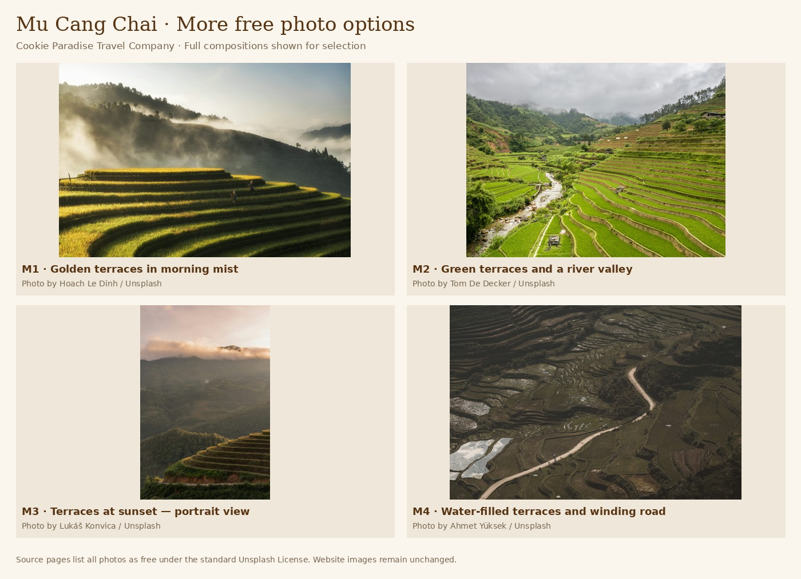
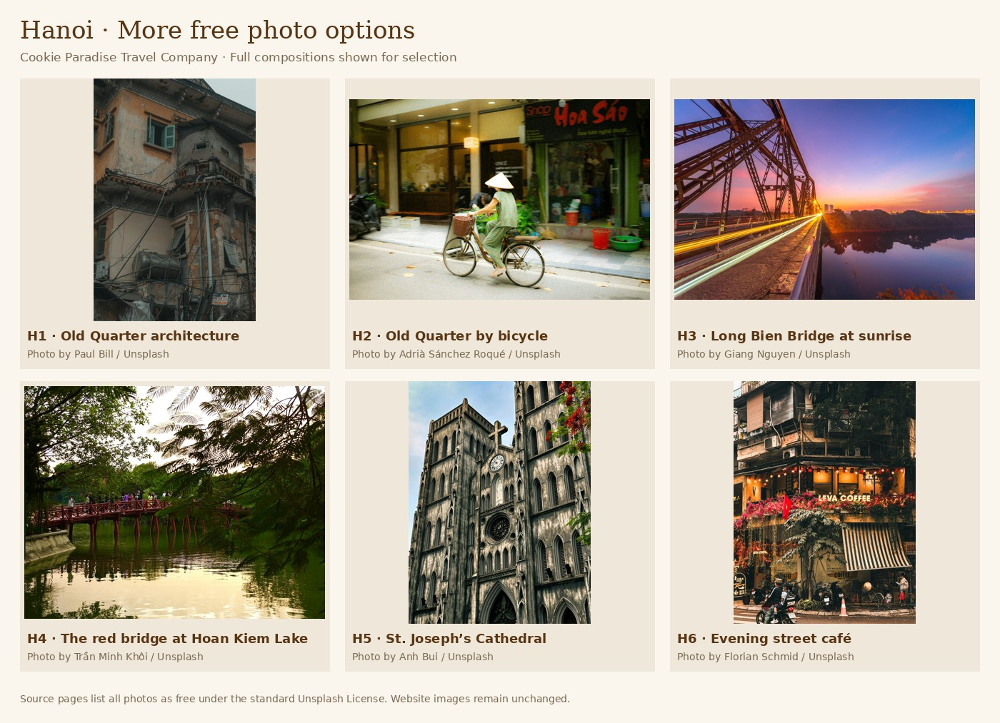

# Additional Mu Cang Chai and Hanoi stock-photo choices

Prepared November 3, 2026. The six earlier A–F options and website draft remain unchanged. This round adds four terrace-field images and six new Hanoi images.

The original source page for every entry was opened and checked for “Download free” and the standard Unsplash License. Photographers and source URLs are retained below and in `options.json`. The comparison boards contain the actual retrieved photos, resized without cropping. No generated imagery is used. No website images or application code have been changed.

| ID | Destination | Scene | Photographer | Source |
| --- | --- | --- | --- | --- |
| M1 | Mu Cang Chai | Golden terraces in morning mist | Hoach Le Dinh | [Unsplash](https://unsplash.com/photos/rice-terraces-in-mu-cang-chai-PeRt3uMmjYM) |
| M2 | Mu Cang Chai | Green terraces and a river valley | Tom De Decker | [Unsplash](https://unsplash.com/photos/rice-terraces-cascade-down-a-lush-green-valley-LrprN_omc7s) |
| M3 | Mu Cang Chai | Terraces at sunset — portrait view | Lukáš Konvica | [Unsplash](https://unsplash.com/photos/terraced-rice-fields-with-mountains-and-clouds-at-sunset-cgmvDZnIHAI) |
| M4 | Mu Cang Chai | Water-filled terraces and winding road | Ahmet Yüksek | [Unsplash](https://unsplash.com/photos/winding-road-through-terraced-rice-paddies-4ZhrI6gLJMA) |
| H1 | Hanoi | Old Quarter architecture | Paul Bill | [Unsplash](https://unsplash.com/photos/an-old-building-with-lots-of-wires-and-wires-hanging-from-it-yD6J3ETko_Y) |
| H2 | Hanoi | A bicycle passing through the Old Quarter | Adrià Sánchez Roqué | [Unsplash](https://unsplash.com/photos/woman-in-conical-hat-rides-bicycle-down-street-rKKCccIPNaQ) |
| H3 | Hanoi | Long Bien Bridge at sunrise | Giang Nguyen | [Unsplash](https://unsplash.com/photos/a-bridge-over-a-river-OJ4GIDdINF0) |
| H4 | Hanoi | The red bridge at Hoan Kiem Lake | Trần Minh Khôi | [Unsplash](https://unsplash.com/photos/a-red-bridge-over-a-body-of-water-HV6Q5-lonX4) |
| H5 | Hanoi | St. Joseph’s Cathedral | Anh Bui | [Unsplash](https://unsplash.com/photos/a-large-cathedral-with-a-clock-on-the-front-of-it-LVzyM-cPcWQ) |
| H6 | Hanoi | A street café glowing in the evening | Florian Schmid | [Unsplash](https://unsplash.com/photos/a-coffee-shop-with-flowers-and-lights-on-a-street-0sTDZrJ72i8) |

For the existing magazine aesthetic, M1 offers a wide landscape with golden terraces and mist; M3 offers a vertical sunset view; H5 and H6 offer portrait compositions with architectural detail. These are design recommendations, not approved selections.

