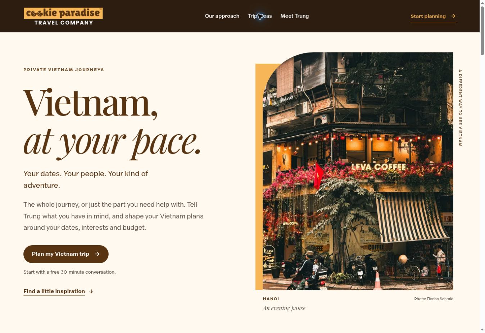
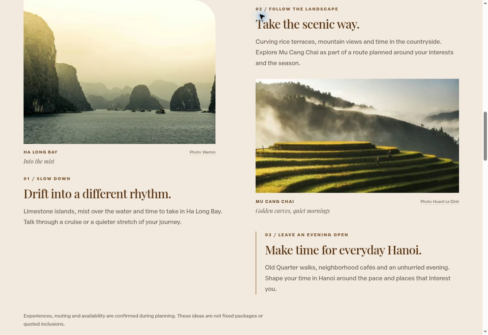
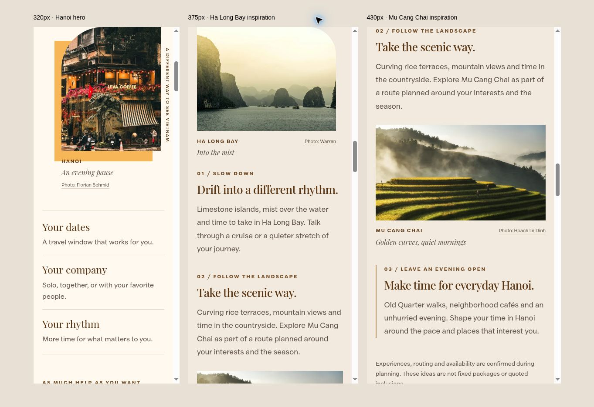

# Selected FIT photography: C, M1 and H6

The owner selected these three photos on November 3, 2026. They are implemented in the draft on PR #17, alongside the requested **From America to Vietnam** introduction and **FIT (Free Independent Travel)** FAQ wording. Deployment approval is pending.

| Selection | Placement | Photographer | Source |
| --- | --- | --- | --- |
| H6 — Hanoi café | Portrait hero, with the existing rounded corner and gold backdrop | Florian Schmid | [Original](https://unsplash.com/photos/a-coffee-shop-with-flowers-and-lights-on-a-street-0sTDZrJ72i8) |
| C — Ha Long Bay | Larger landscape image beside the private-trip inspiration copy | Warren | [Original](https://unsplash.com/photos/boat-surrounder-by-islands--HtfdIHSbsE) |
| M1 — Mu Cang Chai terraces | Offset landscape beneath the countryside story; also the FIT social-preview image | Hoach Le Dinh | [Original](https://unsplash.com/photos/rice-terraces-in-mu-cang-chai-PeRt3uMmjYM) |

Each selected destination photo appears once in the page body. The destination stories and captions now match the selected images. The three images illustrate the destinations and do not identify promised suppliers or package inclusions. The existing explanatory note about confirming routing and experiences remains in place.

The existing FIT typography, color palette, header branding, layout structure, planner portrait, consultation link, editable email template, and native group-trip return link are retained. The group-trip homepage source and its images are unchanged.

## Validation

- Production build, TypeScript, affected-code ESLint, and `git diff --check` passed.
- All nine responsive WebP files decode successfully, have their expected 640/1280/1800-pixel widths, and exactly match the build output. One empty intermediate derivative was regenerated and the complete asset check repeated after a fresh build. See `assets.json` for dimensions and byte sizes.
- The FIT render references only the three selected destination-photo families. Every referenced responsive image exists; the old destination photos are absent from the FIT render and social-preview metadata.
- Static browser review at desktop width and 320/375/430-pixel phone widths confirmed image loading, readable captions, and no horizontal overflow. No local fragment links have missing targets.
- In the referral preview, the Columbus Uppercuts logo remains visible and the editable trip-ideas email retains its referral name. The planning anchor and native return link to the group-trip homepage were clicked successfully.
- The preview renders the actual page components with built CSS and stubs server cookies/availability. Forms, email delivery, booking, and payments were not submitted or exercised; their code was not changed. Live production verification follows approved deployment.

The free stock sources and original-file hashes are recorded in [the asset manifest](../../public/travel/ASSET-SOURCES.md). Local responsive files avoid external image-service requests; the visible credits link to the original listings.

