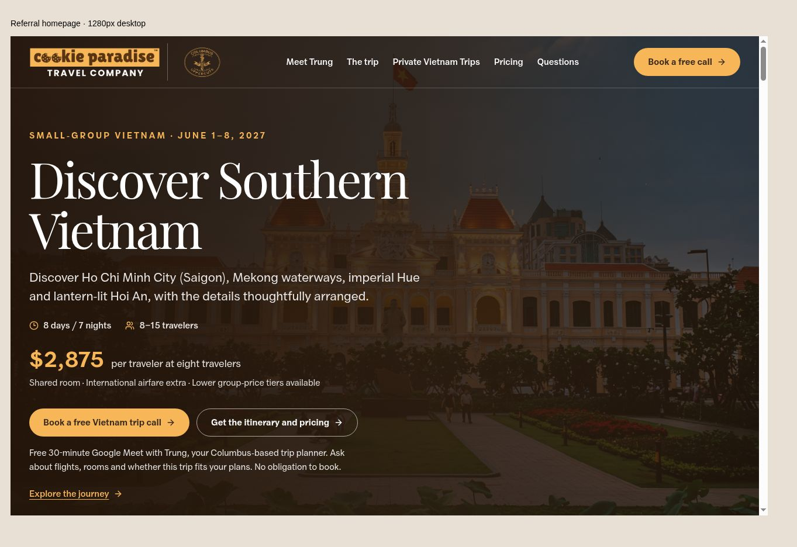
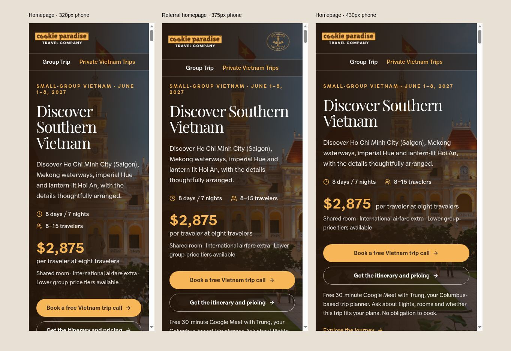

# Public link audit and private-trip navigation

Reviewed November 2–3, 2026 against production and main commit `98f02dc1b2799199073fb0351304e084b359ab44`.

The checkout was clean before this work. No `AGENTS.md` was found. The existing FIT page, photography, typography, unboxed company logo, and referral header layout were already present and were retained.

## Navigation change

The homepage now links to the existing `/fit` page as **Private Vietnam Trips**. The wording describes a flexible private travel service without requiring visitors to understand FIT. The desktop menu includes the link alongside the group-trip navigation. Below the desktop breakpoint, a separate navigation row offers **Group Trip** and **Private Vietnam Trips**, keeping the logos distinct and the consultation action out of the phone header.

## Public-page results

| Page | Rendered anchor occurrences | Missing local anchor targets |
| --- | ---: | ---: |
| `/` | 30 | 0 |
| `/vietnam` | 16 | 0 |
| `/fit` | 18 | 0 |
| `/privacy` | 2 | 0 |
| Total before the menu addition | **66** | **0** |

These links resolve to **25 unique destinations**: 23 HTTPS destinations and two email links. Hidden responsive navigation is included in the anchor count. The draft adds three anchor occurrences, using existing destinations.

| Destination group | Result |
| --- | --- |
| Four public pages and their section anchors | Pages rendered in the live browser; every local and cross-page fragment resolved to an existing element. The Vietnam page's daily-itinerary link was also clicked and reached `/#daily-schedule`. |
| Google consultation calendar | Opened “30-minute Vietnam Trip Consultation with Trung.” No appointment was booked. |
| Five Unsplash photo-credit links | All opened their corresponding photo pages. An initial browser-verification page cleared after one reload. |
| Public trip-guide PDF | Opened the live two-page PDF in the browser. The repository PDF also parsed successfully. |
| Four embedded PDF links | Three calendar annotations use the verified calendar URL. The insurance annotation reached Seven Corners, displaying Cookie Paradise Travel Company LLC agent information. |
| Email address and editable FIT email template | Valid `mailto:trung@cookieparadise.co` destinations; subject/body encoding checked. Email-client handling and mailbox delivery were not tested. |
| Booking request entry | The live homepage button opened the request form and retained the existing referral branding. Its privacy destination is the verified `/privacy` page. No form was submitted. |
| Guide-form success links | Source-checked: the PDF and calendar destinations match the independently verified URLs. The success state was not triggered by a submission. |
| Nine partner referral routes | Local execution of the actual GET handler returned 303 to the homepage with each correct secure referral cookie. All nine QR downloads and logo assets exist. This does not constitute nine live redirect tests. |

No broken public link destination was found. Terminal HTTP probes returned access errors for some pages that rendered successfully in the browser; those responses were not classified as broken links.

## Validation and limits

- Production build and TypeScript check passed.
- Homepage ESLint check: zero errors and one existing image-optimization warning.
- Existing referral and trip-guide test suites: **37 passed, zero failed**.
- Static visual proofs generated from the actual page components and built CSS were checked at 320, 375, 430, 768, and 1280 pixels. The checked layouts have no horizontal overflow or header/hero-text overlap. The private-trip menu link was clicked successfully in the phone preview.
- The visual preview stubs server cookies/availability and does not run form submissions. Referral layouts were rendered explicitly for visual review.
- Protected admin pages, issued traveler/agreement/payment URLs, email delivery, submissions, and payments were not exercised. This was a public navigation audit, not an end-to-end transaction test.
- This audit was initially prepared before deployment. See the follow-up below for an issue caught by live click testing.

## Deployment follow-up: public-page navigation

After PR #15 deployed successfully, an actual click on the new desktop menu link stayed on the homepage. The browser reported a vinext client-routing exception (`TypeError: e is not a function`) in its link chunk, along with an RSC-prefetch setup error. The URL and destination page were valid, but the hydrated framework link intercepted the click and failed to navigate.

The fix replaces the ten `next/link` instances on the four public pages with native anchors. This covers the new desktop/mobile menu links, existing public-page logos, footer links, and the privacy page's return link. Destinations, wording, styling, and referral cookies are unchanged. A normal page load also lets each destination read the existing referral cookie on the server. Protected admin and issued booking/payment flows are outside this focused change.

The production build, TypeScript, and public-page ESLint checks must pass before release. Live release verification must click from the homepage menu to `/fit`, return through its logo/footer, and exercise the Vietnam/privacy return links; URL existence alone is insufficient to verify client-side click behavior.

