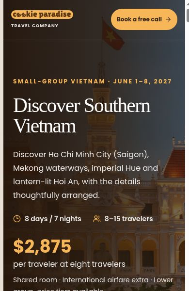

# Mobile header spacing

The homepage header now gives the logo and “Travel Company” a clear left-hand group and keeps “Book a free call” on the right. On screens under 640px, the call button has a 44px minimum height and a compact label. Referral logos occupy a separate row, with extra space before the hero copy. Desktop layout and consultation URLs are preserved.

Validation: production build, TypeScript and whitespace checks passed. Targeted lint reported no errors and the same three pre-existing image warnings in the homepage. Static visual proofs rendered from the actual page components and production CSS were checked at 320px, 375px, 430px and desktop width. Each phone view fits without horizontal overflow or overlapping header elements. The referral view has 51px clearance between the header and hero copy.

This is a static visual review; booking submissions and payment transactions were not exercised. Production deployment is pending owner approval.

