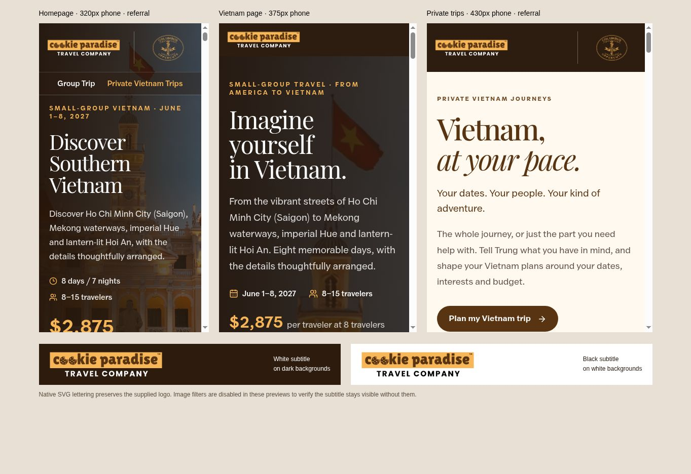

# Mobile logo subtitle contrast

Prepared from clean production main commit `1342e797590ee5198a61011c22a398810742d341` on November 3, 2026. No `AGENTS.md` was found.

The owner reported that **Travel Company** appeared black against the dark mobile header. All three landing-page headers already pass `surface="dark"`, but the previous component displayed the black subtitle from the supplied PNG and relied on a CSS image filter to turn it white. A browser that ignores that filter can display the original black lettering.

The shared logo now uses native SVG paths for the subtitle, with an explicit white fill on dark surfaces and black fill on light surfaces. The paths are traced from the supplied artwork rather than typeset in a replacement font. The wordmark image, transparent background, SVG view box, logo dimensions, subtitle alignment, and partner-logo layout are retained. The supplied PNG itself is unchanged.

`brand-logo-subtitle.ts` contains the traced paths. `trace-subtitle.py` records the one-off derivation using Pillow; it is not a production dependency or build step. The source hash, crop, alpha threshold and sub-pixel simplification tolerance are recorded in `trace.json`. Before simplification, the summed contour area exactly matches the 22,812 opaque source pixels.

## Verification

- Production build, TypeScript, affected-component ESLint, and `git diff --check` passed.
- Browser previews at 320, 375 and 430 pixels show a white subtitle on the homepage, Vietnam landing page and private-trip page. Referral examples retain their logos and spacing; there is no horizontal overflow.
- SVG image filters were explicitly disabled in the preview. Each header subtitle still renders with `fill="#ffffff"`; no image-filter styling remains in the logo component.
- The light-surface example renders with `fill="#000000"` on white, preserving the earlier brand requirement.
- The preview renders the actual components with the built CSS, using server-cookie and availability stubs. Chromium phone-width layouts were inspected; physical iOS/Safari and Android devices were not directly tested.
- No booking, payment, referral-tracking, navigation, business-term or page-copy code was changed. No forms were submitted.

Draft only; deployment approval is pending.

