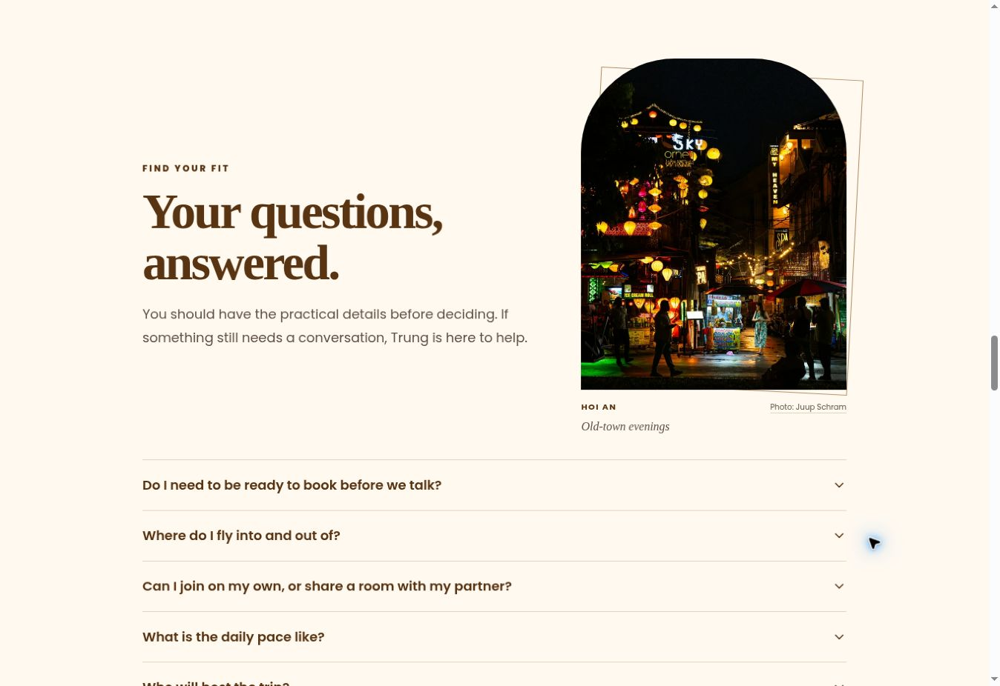
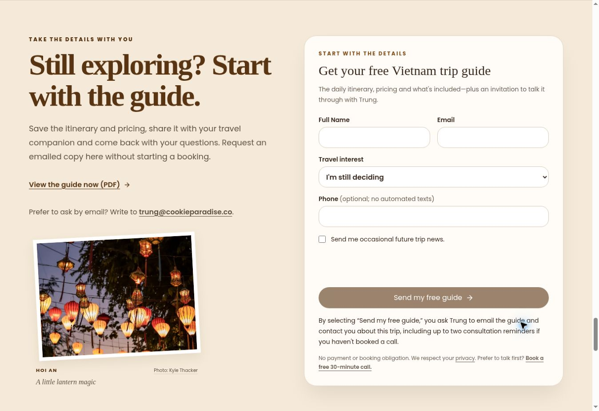
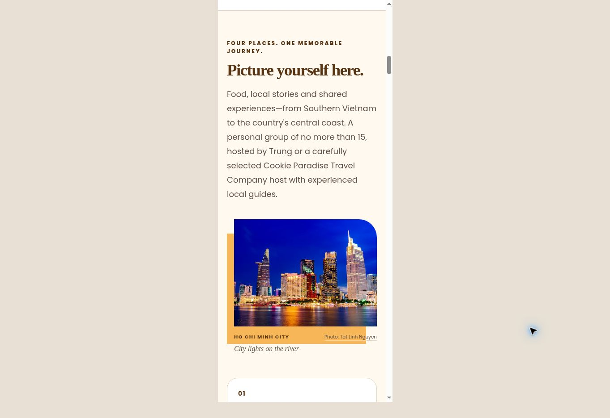

# Editorial travel photography review

Five destination photographs are distributed through the existing homepage and `/vietnam` landing page. Partner referrals use the same homepage. Image sources and license information are recorded in `public/travel/ASSET-SOURCES.md`.

- Varied landscape and portrait crops, staggered alignment, an arched Hoi An frame and a small tilted lantern print replace a uniform photo-card treatment.
- Existing copy, prices, form components, action links, referral logic, agreement/payment code and Cloudflare configuration are preserved. The itinerary sidebar scrolls normally now that it includes a photograph.
- Each photograph has descriptive alt text, visible credits, local WebP variants, explicit dimensions and native lazy loading.

## Validation

- 193 existing tests passed.
- TypeScript passed.
- Lint: 0 errors; the same 7 existing image warnings.
- Production build passed.
- Source comparison confirmed existing page copy and action targets are unchanged.
- Desktop and 390px iframe viewport visual checks used static HTML rendered from the actual updated page components with the production CSS. All five homepage photos loaded; no horizontal overflow was observed. This verifies presentation, not a complete interactive or physical-device test.

The full preview Worker cannot start in this environment: its available runtime supports compatibility dates only through 2026-05-22, while the existing application requires 2026-09-26. No application compatibility settings were changed. The static visual proof omits server cookie/availability lookups and client scripts. No real inquiries, emails, agreements or payment transactions were submitted.

Screenshots below show the static visual proof, not a production deployment.

